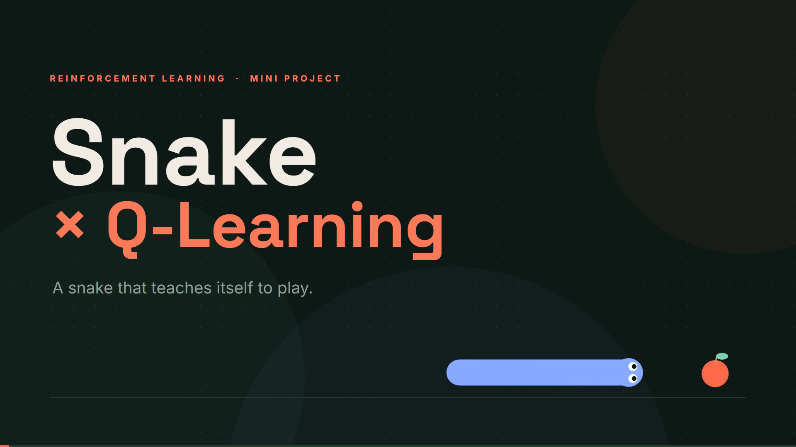
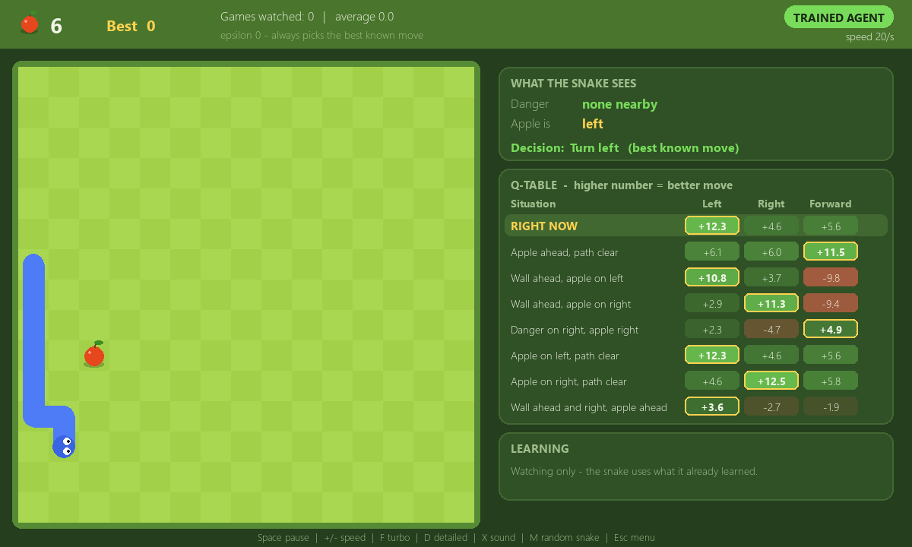
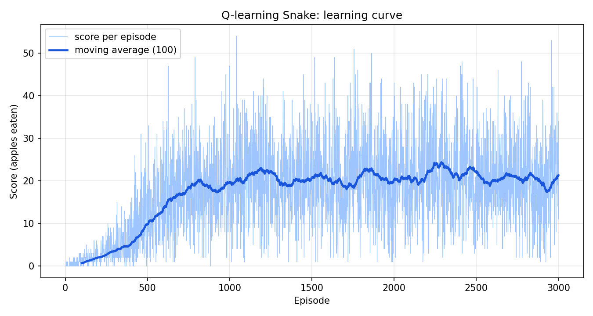

# Snake × Q-Learning

**A snake that teaches itself to play, using Reinforcement Learning.**
Nobody programs the rules of "how to play well". The snake plays thousands of games, gets rewards and penalties, and slowly learns which move is best in every situation.

> Deep Learning & Reinforcement Learning (DLRL) mini project

**Team:** Evans Pereira (10689) · Dakshat Jain (10663) · Shaurya Sanil (10698)

---

## Demo video (3 min 50 s)

[](demo_video/Video_2_SFX_Voiceover.mp4)

Click the picture to open the video. It explains the whole project visually: what the snake sees, the Q-table, the update formula with three real examples from training, why it looks at the next situation, what a Q-value really is, delayed gratification, and the results.

There are two versions of the same video:

| Version | File | For |
|---|---|---|
| **Video 2: with voiceover** | [`demo_video/Video_2_SFX_Voiceover.mp4`](demo_video/Video_2_SFX_Voiceover.mp4) | Watching on its own |
| **Video 1: sound effects only** | [`demo_video/Video_1_SFX.mp4`](demo_video/Video_1_SFX.mp4) | Presenting live while speaking over it |

The voiceover text is listed in [`demo_video/voiceover_script.txt`](demo_video/voiceover_script.txt).

## The app



The window shows the game on the left and, on the right, what the snake sees, the part of the Q-table it is looking at, and what it learned from the last move.

---

## How it works

The snake uses **tabular Q-learning**: a table that holds one score for every move in every situation.

| Idea | In this project |
|---|---|
| **State (situation)** | 7 yes/no facts, all from the snake's own point of view: danger ahead / right / left, and apple ahead / behind / left / right. That gives 2⁷ = **128 situations** (about 64 actually occur). |
| **Actions** | 3 moves: straight, turn right, turn left. |
| **Reward** | +10 for eating an apple, −10 for crashing (wall, itself, or wandering too long), 0 otherwise. |
| **Q-table** | 128 rows × 3 columns. Each number is how good that move is in that situation, in the long run. |

After every move the snake updates one number in the table:

```
Q[s][a]  ←  Q[s][a] + α · ( reward + γ · max Q[s'] − Q[s][a] )
```

- `α = 0.1` (learning rate): how big each step toward the target is.
- `γ = 0.9` (discount factor): how much future rewards count. This is how the value of an apple spreads backward to the moves that led to it.
- `max Q[s']` is the best score in the situation the move lands in.
- **Exploration:** ε-greedy. At first 100% of moves are random; ε shrinks by ×0.995 every game, down to 1%.

All settings are in [`config.py`](config.py).

## Results

The snake was trained for **3,000 games (about 10 seconds)** and then tested on **100 fresh games** it had never seen, with learning switched off:

| Agent | Average apples per game | Best game |
|---|---|---|
| Random snake | 0.12 | 2 |
| **Trained Q-agent** | **23.2** | 45 |



`results/` also contains the exploration curve, the evaluation numbers, and the **full Q-table** (all 128 situations) as a web page and a spreadsheet: [`results/full_q_table.html`](results/full_q_table.html).

---

## Run it yourself

Needs Python 3.10 or newer.

```bash
git clone <this repository>
cd <folder>
python -m venv venv
venv\Scripts\activate          # Windows   (Linux/Mac: source venv/bin/activate)
pip install -r requirements.txt
python main.py                 # opens the app
```

| Command | What it does |
|---|---|
| `python main.py` | Open the app: train it, watch the trained snake, or play yourself |
| `python main.py train` | Train headlessly (3,000 games, ~10 s), save the table and the graphs |
| `python main.py evaluate` | Trained snake vs random snake on 100 fresh games |
| `python main.py inspect` | Print what the table learned, in plain English |
| `python main.py watch` / `human` | Jump straight into a mode |
| `python show_full_table.py` | Write all 128 situations to `results/full_q_table.html` and `.csv` |
| `python -m pytest` | Run the 26 automated tests |

**In the app:** `Space` pause · `+`/`−` speed · `F` turbo · `D` detailed view · `X` sound on/off · `S` save · `N` start from an empty table · `M` random snake (watch mode) · `Esc` menu.

The results are reproducible: training uses a fixed random seed (42), and testing uses a different seed so the test games are new to the snake.

## Project structure

```
config.py           all settings (learning rate, discount, rewards, ...)
game.py             the Snake world: moves, walls, rewards, and what the snake "sees"
agent.py            the brain: the Q-table, choosing a move, and learning
train.py            plays the games and calls the agent's learn() after every move
evaluate.py         tests the trained snake against a random snake
inspect_q.py        prints what the Q-table learned
show_full_table.py  writes the full Q-table as a web page and a spreadsheet
plot.py             training graphs
main.py             launcher for everything
ui/                 the window: menu, board, side panel, sounds
tests/              26 automated tests
results/            graphs, evaluation numbers, the full Q-table
docs/               images and the project report
demo_video/         the explainer video (two versions) and the voiceover script
q_table.npz         the trained table (3,000 games)
```

## Limitations and next steps

The snake only knows the 7 facts above. It can't see the shape of its own body, so in long games it can trap itself, and it can't plan long detours. A table is also too small for bigger problems. The natural next step is **DQN** (Deep Q-Network): replace the table with a small neural network so the snake can use a much richer view of the board.

## Team

| Name | Roll no. |
|---|---|
| Evans Pereira | 10689 |
| Dakshat Jain | 10663 |
| Shaurya Sanil | 10698 |

*Academic mini project for Deep Learning & Reinforcement Learning.*
